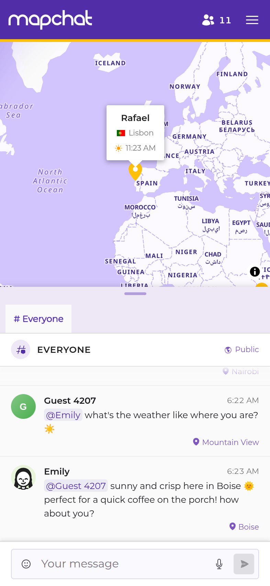
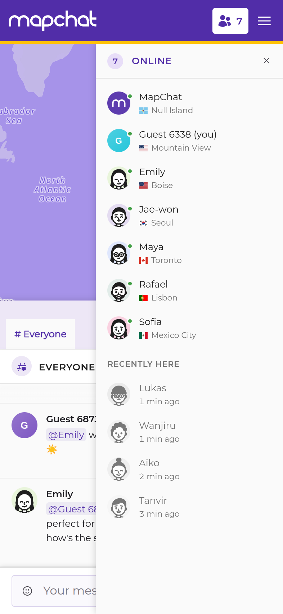
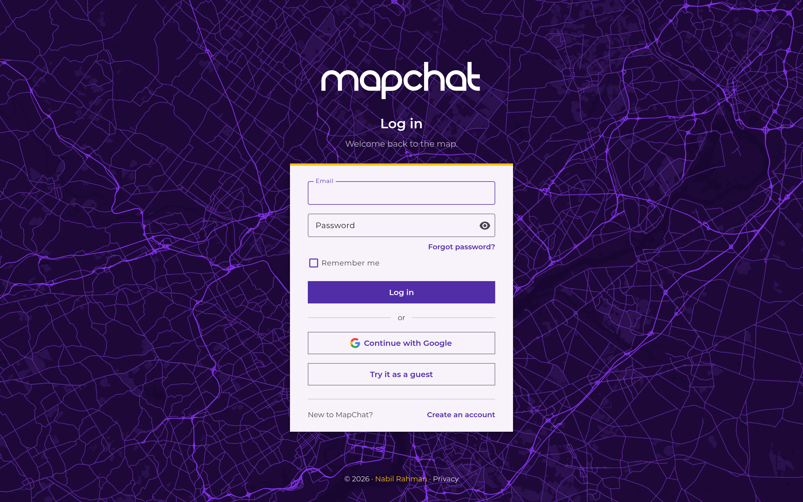

<div align="center">

<picture>
  <source media="(prefers-color-scheme: dark)" srcset="public/images/logo-mapchat-white.svg">
  
</picture>

An open chat room on a map, running on an MVC framework<br>
I wrote from scratch in PHP.

[](https://mapchat.swiftsolve.net)
[](https://github.com/nabilrhman/MapChat-MVC/actions/workflows/tests.yml)<br>
[](composer.json)
[](database/init.sql)
[](Dockerfile)
[](LICENSE)

**[Open MapChat](https://mapchat.swiftsolve.net)** &nbsp;·&nbsp;
**[AI chat](#ai-chat)** &nbsp;·&nbsp;
**[Run it locally](#run-it-locally)** &nbsp;·&nbsp;
**[Deploy for free](#deploy-for-free)** &nbsp;·&nbsp;
**[Project layout](#project-layout)**

</div>

---

## Overview

MapChat is an open chat room on a map. Everyone who signs in talks in the same
room, and a pin on the map shows which city each person is chatting from.

I built it in 2018 as a university project at Boise State University. The goal
was to understand what a web framework actually does, so instead of using one, I
wrote my own: the router, controllers, models, views, sessions and login are all
hand-written PHP.

In 2026 I came back to it to bring parts of it up to date.

[MapChat](https://mapchat.swiftsolve.net) runs on Render's free plan, which
sleeps when nobody visits, so the first visit after a quiet spell takes about
a minute to load.

https://github.com/user-attachments/assets/fe2ddbd9-c84c-4cbc-b512-e040cd0d9902

<sub>A quick tour of MapChat.</sub>


<div align="center">
<table>
  <tr>
    <th>On a phone</th>
    <th>The online list on a phone</th>
  </tr>
  <tr>
    <td></td>
    <td></td>
  </tr>
</table>
</div>

| Login | Profile |
|---|---|
|  |  |

| Account activation email | Password reset email |
|---|---|
|  |  |

## Features

- One open chat room for everyone signed in, live over a WebSocket.
- Private chats in tabs, with unread counts and "Typing...".
- @mentions, emoji and voice typing in the message box.
- Notifications for private messages and @mentions, even with MapChat closed.
- A pin for each person online, placed from their IP address, never GPS,
  with their local time. Anyone can hide theirs.
- Hover a person or a message's city to point out their pin; click the city
  to fly the map there. The night side of the world is shaded.
- MapChat, the room's AI, and nine AI characters who chat back.
- Try it as a guest, with no sign-up, for 24 hours.
- Sign up with email or Continue with Google, with a nickname and avatar.
- Delete your profile, and everything of yours goes with it.
- On a phone, the chat is a sheet over the map that you drag.

Every feature in full: [docs/features.md](docs/features.md).

## AI chat

Two kinds of AI share the room, and Groq's chat API writes what both say.

- **MapChat**, the room's own account, greets people walking into a quiet
  room, answers anyone nobody else answered, and answers private messages.
- **The characters**, the nine people on the map, play out the day's stories
  and answer in character when mentioned or messaged. Asked, they say
  they're AI.

Without `GROQ_API_KEY`, MapChat only greets and the characters only follow
their script. When each answers, what they read and what goes to Groq:
[docs/ai-chat.md](docs/ai-chat.md).

## How it's built


- **Framework:** MVC written from scratch in PHP 8.4 (`Core/`); the app is
  in `App/`.
- **Database:** MySQL, with prepared statements. Sessions live there too.
- **Views:** Twig 3, which escapes what users type, behind a strict
  Content-Security-Policy.
- **Front end:** the site's own CSS in Material 3's colours, and plain
  JavaScript.
- **Live chat:** a WebSocket per chat page, served by a PHP process on
  [amphp](https://amphp.org), falling back to HTTP:
  [docs/live-chat.md](docs/live-chat.md).
- **Notifications:** Web Push from the chat worker:
  [docs/notifications.md](docs/notifications.md).
- **Map:** MapLibre with OpenFreeMap; Leaflet where there's no WebGL.
- **Hosting:** one Docker image with Apache, PHP-FPM, the chat socket and
  the chat worker.

Security, location, email, Google sign-in, avatars and icons:
[docs/how-its-built.md](docs/how-its-built.md).

## Run it locally

You need Docker.

```bash
cp .env.example .env   # then set SECRET_KEY, e.g. to the output of: openssl rand -hex 32
docker compose up --build
```

Open http://localhost:8080 and sign up, or press **Try it as a guest**.

- Nine made-up people (`database/demo.sql`) keep the room and the map busy.
  For an empty room, remove the `demo.sql` line from `docker-compose.yml`.
- A free Groq key from console.groq.com, as `GROQ_API_KEY` in `.env`, makes
  MapChat and the demo people chat back.
- Emails don't go out locally. They land in Mailpit, at
  http://localhost:8025.
- Code changes show on reload, except in the chat socket and worker: run
  `docker compose restart app` after changing `App/ChatSocket/`, `bin/` or a
  model they use.

To start over with an empty database:

```bash
docker compose down -v
```

### Tests

PHPUnit covers the router, who sees which messages, mentions, Web Push, when
the AI answers, and the chat socket run as its own process. The tests use
their own database, `mapchat_test`, so the app's data is never touched:

```bash
docker compose run --rm --build test
```

With the app running, `npm install` once, then `npm run a11y` checks every
page with axe-core at desktop and phone widths, in Playwright.

### Settings

All settings come from environment variables, explained in `.env.example`.
The full list: [docs/settings.md](docs/settings.md).

## Deploy for free

MapChat runs free as a Docker container on [Render](https://render.com), with
the database on [TiDB Cloud Starter](https://tidbcloud.com). The steps, from
creating the database to the optional email, avatar and AI settings, are in
[docs/deploy.md](docs/deploy.md).

## Project layout

```
Core/              The framework: router, base controller and model, views, errors
App/Controllers/   One class per page or action; Room is the chat page
App/Models/        Database access, and Bot: when MapChat and the demo people answer
App/Bot/           What the bot is told, who isn't a real person, and Groq, which writes the replies
App/Messages/      A message's conversation, @mentions, voice clips, and rows for one reader
App/SignIn/        Who is logged in, Google sign-in, and the tokens in links and cookies
App/Notify/        Email, and Web Push to closed browsers
App/*.php          Settings, flash messages, names and avatar pictures
App/ChatSocket/    The live chat: who's let in (Handshake), what each page gets (Hub)
App/Views/         Twig templates; a partial's name starts with _
bin/               The chat socket and the chat worker, run by docker/start.sh
public/            Web root: index.php, CSS, JavaScript, sw.js, images, icons.svg
public/js/         Scripts by part: core/ on every page, chat/, messages/, map/, notify/, sign-in/, forms/, profile/
public/css/        Styles by part: core/ on every page, chat/, and pages/ for the rest
database/          The schema, the demo people and their day, and migrate.php
tests/             PHPUnit tests, in folders like App/'s and Core/'s; tests/Support/ their helpers; tests/browser/ the Playwright checks (npm run a11y)
docs/              How each part works, deploying, and the load test
docs/images/       The video, screenshots and diagram in this README
docs/tools/        The tools behind the docs: the tour and screenshots (npm run tour, npm run screenshots), the diagrams and the load test
AGENTS.md          The coding rules, for people and AI agents alike
```

## Author

Nabil Rahman · [nabilr.com](https://nabilr.com)
