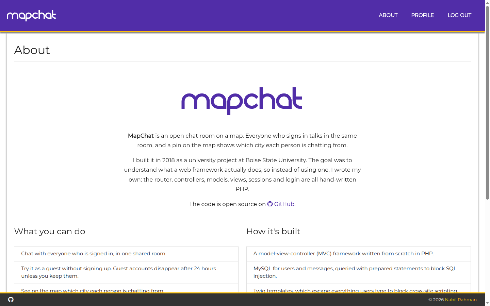

# MapChat

MapChat is an open chat room on a map. Everyone who signs in talks in the same
room, and a pin on the map shows which city each person is chatting from.

I built it in 2018 as a university project at Boise State University. The goal
was to understand what a web framework actually does, so instead of using one, I
wrote my own: the router, controllers, models, views, sessions and login are all
hand-written PHP.

**Live:** https://mapchat-z4tj.onrender.com (free hosting, so the first visit
after a quiet spell takes about a minute to wake up)


| Log in, or try it as a guest | About |
|---|---|
|  |  |

## Features

- One shared chat room for everyone who is signed in. New messages show up
  within a second.
- A map with a pin for each person, placed by their IP address at roughly city
  level. Nobody's exact location is ever shown.
- Anyone can hide their pin and city from the map in their profile.
- Visitors can try it as a guest without signing up. Guest accounts and their
  messages are deleted after 24 hours, unless the guest sets an email and
  password in their profile to keep the account.
- Accounts with email activation and password reset. Without email configured,
  new accounts are active straight away.
- Profiles with a name and an avatar.
- Limits that keep one person from flooding the room: messages are at most 500
  characters, and each person can send 30 a minute (10 for guests).

## How it's built

- **Framework:** a model-view-controller (MVC) framework written from scratch in
  PHP 8.4, in `Core/`. The app itself is in `App/`.
- **Database:** MySQL, queried with prepared statements to block SQL injection.
- **Views:** Twig 3 templates, which escape everything users type to block
  cross-site scripting.
- **Front end:** Materialize CSS, jQuery for the page, and axios for every
  request to the server. The chat asks for new messages every second.
- **Map:** MapLibre with OpenStreetMap data from OpenFreeMap, styled to match
  MapChat's colours. Browsers without WebGL get OpenStreetMap tiles through
  Leaflet instead, recoloured to the same theme in the browser. No API key is
  needed for either.
- **Location:** looked up from the visitor's IP address with ipapi.co, or
  ipstack when `IPSTACK_API_KEY` is set.
- **Email:** Symfony Mailer, sending through any SMTP provider.
- **Sessions:** stored in MySQL rather than files, so restarting or waking up
  the container doesn't log anyone out.
- **Avatars:** uploaded from the browser straight to Cloudinary.
- **Hosting:** a Docker image with Apache and PHP.

## Run it locally

You need Docker.

```bash
cp .env.example .env   # then set SECRET_KEY, e.g. to the output of: openssl rand -hex 32
docker compose up --build
```

Open http://localhost:8080 and either sign up or press **Try it as a guest**.

The room starts with a sample conversation between nine made-up people around
the world, from `demo.sql`, so the chat and the map aren't empty. Their
accounts can't be logged into. To start with an empty room instead, remove the
`demo.sql` line from `docker-compose.yml`.

Emails the app sends locally (account activation, password reset) don't go
out. They land in Mailpit, an inbox you can open at http://localhost:8025.

Code changes in `App/`, `Core/` and `public/` show up on reload. After changing
`composer.json` or the `Dockerfile`, run `docker compose up --build` again.

To start over with an empty database:

```bash
docker compose down -v
```

### Settings

All settings come from environment variables. `.env.example` lists them with
explanations. The main ones:

| Variable | What it does |
|---|---|
| `APP_URL` | Public address of the site, used in links inside emails |
| `DB_HOST`, `DB_PORT`, `DB_NAME`, `DB_USER`, `DB_PASSWORD` | Database connection |
| `DB_SSL` | `true` for hosted MySQL that requires TLS |
| `SECRET_KEY` | Secret for hashing login and reset tokens. Required |
| `MAILER_DSN` | SMTP address for outgoing email. Empty turns email off (locally it defaults to Mailpit) |
| `IPSTACK_API_KEY` | Optional. Without it, ipapi.co is used |
| `DEV_FAKE_IP` | Locally every visitor has a private IP; this public IP is used for the map instead |
| `CLOUDINARY_CLOUD_NAME`, `CLOUDINARY_UPLOAD_PRESET` | Where avatar uploads go |

## Deploy for free

The app runs as a Docker container on [Render](https://render.com)'s free plan,
with the database on [TiDB Cloud Starter](https://tidbcloud.com), a free
MySQL-compatible service.

1. Create a TiDB Cloud Starter cluster. In its SQL editor, run
   `CREATE DATABASE mapchat; USE mapchat;`, then the contents of `init.sql`,
   and, if you want the sample conversation, `demo.sql`.
2. In Render, choose **New > Blueprint** and pick this repository. Render reads
   `render.yaml` and asks for the database host, user and password from TiDB's
   **Connect** dialog, and for `APP_URL` (the `onrender.com` address).
3. Optional: set `MAILER_DSN` to turn on activation and password-reset emails,
   and `CLOUDINARY_CLOUD_NAME` / `CLOUDINARY_UPLOAD_PRESET` for avatar uploads.

Free Render services sleep after 15 minutes without visitors, so the first visit
after a quiet spell takes about a minute.

## Project layout

```
Core/            The framework: router, base controller and model, views, errors
App/Controllers/ One class per page or action
App/Models/      Database access for users, chats and locations
App/Views/       Twig templates
public/          Web root: index.php, CSS, JavaScript and images
init.sql         Database schema and the welcome messages
demo.sql         Optional sample people and conversation
```

## Author

Nabil Rahman · [nabilr.com](https://nabilr.com)
