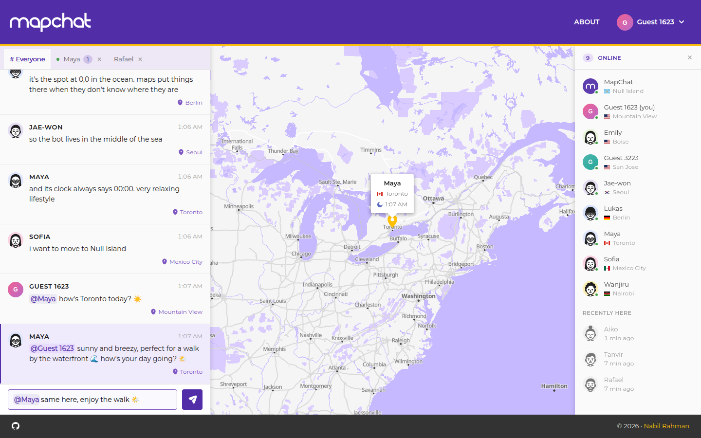

<div align="center">

<picture>
  <source media="(prefers-color-scheme: dark)" srcset="public/res/logo-mapchat-white.svg">
  
</picture>

An open chat room on a map, running on an MVC framework<br>
I wrote from scratch in PHP.

[](https://mapchat.swiftsolve.net)
[](https://github.com/nabilrhman/MapChat-MVC/actions/workflows/tests.yml)<br>
[](composer.json)
[](database/init.sql)
[](Dockerfile)
[](LICENSE)

**[Open MapChat](https://mapchat.swiftsolve.net)** &nbsp;·&nbsp;
**[AI chat](#ai-chat)** &nbsp;·&nbsp;
**[Run it locally](#run-it-locally)** &nbsp;·&nbsp;
**[Deploy for free](#deploy-for-free)** &nbsp;·&nbsp;
**[Project layout](#project-layout)**

</div>

---

## Overview

MapChat is an open chat room on a map. Everyone who signs in talks in the same
room, and a pin on the map shows which city each person is chatting from.

I built it in 2018 as a university project at Boise State University. The goal
was to understand what a web framework actually does, so instead of using one, I
wrote my own: the router, controllers, models, views, sessions and login are all
hand-written PHP.

In 2026 I came back to it to bring parts of it up to date, and I'm still at it.

[MapChat](https://mapchat.swiftsolve.net) runs on Render's free plan, which
sleeps when nobody visits; a GitHub Actions workflow visits it every 10 minutes
so it stays awake.



| Log in, or try it as a guest | Profile |
|---|---|
|  |  |

| Account activation email | Password reset email |
|---|---|
|  |  |

## Features

- One shared chat room for everyone who is signed in. New messages show up
  the moment they're sent, over a WebSocket.
- Private chats: click someone's name to talk to just them, in a tab of its
  own, with a count of the messages you haven't seen yet. Reading them in one
  browser tab clears the count in your others, and "Typing..." shows while
  the other person is writing to you.
- Who's online updates as people come and go, on the list and on the map.
- MapChat, the room's AI, and the regulars on the map, who are AI characters
  too: see [AI chat](#ai-chat).
- @mentions in the room: type @ to pick someone. Mentions show as chips, your
  own stand out, and a mention in a tab you're not looking at turns its count
  purple.
- Names show as first names. Signed-up people can pick a nickname, which shows
  instead and is what others @mention them by. Guests stay "Guest 1234".
- A map with a pin for each person online, placed by their IP address at
  roughly city level. Nobody's exact location is ever shown. A pin's label
  shows their city and local time, with a sun or moon; hovering someone in
  the list or a message's city points their pin out, and clicking the city
  brings it to the middle of the map.
- Anyone can hide their pin and city from the map in their profile.
- On phones the map starts hidden to give the chat the room. A button shows
  it above the chat, and the chat can then fold down to its tabs to give the
  map the whole screen.
- Visitors can try it as a guest without signing up. Guest accounts and their
  messages are deleted after 24 hours, unless the guest sets an email and
  password in their profile to keep the account.
- Accounts with email activation and password reset. Without email configured,
  new accounts are active straight away.
- Profiles with a name and an avatar.
- Limits that keep one person from flooding the room: messages are at most 500
  characters, and each person can send 30 a minute (10 for guests).

## AI chat

Two kinds of AI share the room, and Groq's chat API (`openai/gpt-oss-120b` by
default) writes what both say. Without `GROQ_API_KEY`, MapChat only greets and
the regulars only follow their script.

**MapChat**, the room's own account, pinned on Null Island:

- Says hello when someone walks into a quiet room, once a day per person.
- Answers someone nobody else answered: at once if nobody else is online,
  otherwise after giving others 45 seconds.
- Keeps a conversation going without being @mentioned, and steps back as soon
  as people talk to each other. An @MapChat always gets an answer.
- Answers private messages.

**The regulars**, the nine people on the map, are digital characters. Through
the day they play out stories from `database/demo-chat.php`, and:

- @mention one in the room, or message them privately, and they answer in
  character, coming online first if they were away.
- While a guest talks with one in the room, the story waits, and goes on from
  where it was once that conversation goes quiet.
- Asked whether they're real, they say they're MapChat's digital characters,
  written by AI.

Both of them:

- Tag who they're answering (MapChat when other messages came in between, the
  characters always), keep replies short, and stop asking questions once
  someone's done chatting.
- Read only what they need: a room reply reads the room's recent messages, a
  private reply only that one private chat. That text is sent to Groq.
- Wait their turn as jobs in `mapchat_jobs`, which the chat worker
  (`bin/chat-worker.php`) runs as they come due, each checked against the room
  again just before it posts.

The code is in `App/Models/Bot.php`.

## How it's built


- **Framework:** a model-view-controller (MVC) framework written from scratch in
  PHP 8.4, in `Core/`. The app itself is in `App/`.
- **Database:** MySQL, queried with prepared statements to block SQL injection.
- **Views:** Twig 3 templates, which escape everything users type to block
  cross-site scripting.
- **Front end:** the site's own CSS, in Material 3's colours and states
  (generated from MapChat's purple) with square corners, and Beer CSS for
  the form fields, scoped so it styles nothing else. Plain JavaScript with no
  jQuery, and axios for requests to the server.
- **Live chat:** one WebSocket per open chat page, served by a PHP process of
  its own on [amphp](https://amphp.org); see [Live chat](#live-chat).
- **Icons:** the Bold weight of the [Solar icon set](https://www.figma.com/community/file/1166831539721848736)
  by 480 Design, under [CC BY 4.0](https://creativecommons.org/licenses/by/4.0/),
  in one sprite, `public/icons.svg`. The GitHub mark is from Simple Icons.
- **Map:** MapLibre with OpenStreetMap data from OpenFreeMap, styled to match
  MapChat's colours. Browsers without WebGL get OpenStreetMap tiles through
  Leaflet instead, recoloured to the same theme in the browser. No API key is
  needed for either.
- **AI replies:** Groq's chat API, run by the chat worker; see
  [AI chat](#ai-chat).
- **Location:** looked up from the visitor's IP address with ipapi.co, or
  ipstack when `IPSTACK_API_KEY` is set.
- **Email:** Symfony Mailer, sending through any SMTP provider or Brevo's API.
- **Sessions:** stored in MySQL rather than files, so restarting or waking up
  the container doesn't log anyone out.
- **Avatars:** uploaded from the browser straight to Cloudinary.
- **Hosting:** a Docker image with Apache, PHP-FPM, the chat socket and the
  chat worker.

## Live chat

Each open chat page keeps one WebSocket to `/ws`, on the site's own address.
Everything the chat does goes over it: new messages, sending, older pages,
read marks, typing, and who's online. Nothing polls while it's connected.

- **One reader for everyone.** The chat socket (`bin/chat-socket.php`,
  `App/ChatSocket/`) reads new messages from MySQL in id order and sends each
  to the pages allowed to see it: the open room's to everyone, a private one
  only to its sender's and recipient's pages. Every process that saves a
  message (PHP-FPM, the worker, the socket itself) signals it over local UDP,
  so it's read at once; without a signal it's read within half a second.
- **Sending.** A page sends each message with an id it made, and the server
  answers once the message is in the database. If the answer is lost, the page
  sends it again with the same id after reconnecting, and gets back the first
  message instead of a second copy (a unique key on `chats.client_id`).
- **Reconnecting.** A page says which message it has last whenever it
  connects, and is caught up from MySQL from there, a page of 100 at a time,
  before new messages go straight to it. So a dropped network, a restart or a
  deploy loses nothing, and each message shows once and in order. A page that
  can't keep up is cut and catches up the same way.
- **Falling back.** If the socket can't connect twice in a row, the page goes
  back to asking every second over HTTP, and keeps trying the socket; once it
  connects, polling stops. Both ways resume from the same last message.
- **Who's online.** Someone is online while any of their tabs has a socket
  open, and for 10 seconds after their last one closes, so a reload or a brief
  drop doesn't show them leaving. The socket pings each page every 10 seconds
  and drops one that misses three.
- **Typing.** "Typing..." goes only to the other person in a private chat,
  never the text, at most every 2 seconds, and stops after 6 without a key, on
  sending, on switching chats, or when the tab closes.
- **Who's let in.** Only pages from the site itself (checked by Origin), with
  a logged-in session cookie, as the HTTP chat. Every action is the session's
  user's, checked again by the server, and logging out (or a guest account
  expiring) closes the socket within 15 seconds. Messages over 16 KB, anything
  but JSON text, and floods are refused.

The container's main process (`docker/start.sh`) starts PHP-FPM and Apache at
once, brings the database up to date (`database/migrate.php`), then starts
the chat socket and the chat worker, and starts either again a second after
it stops. On SIGTERM, a deploy or a restart, the socket closes every page's
socket with "restarting" and the pages reconnect to the new container within
a few seconds, at random, so they don't all arrive at once. The chat worker
does what each poll used to set off: MapChat's due replies every second, and
the demo people's due lines every minute.

## Run it locally

You need Docker.

```bash
cp .env.example .env   # then set SECRET_KEY, e.g. to the output of: openssl rand -hex 32
docker compose up --build
```

Open http://localhost:8080 and either sign up or press **Try it as a guest**.

Nine made-up people around the world, from `database/demo.sql`, keep the chat
and the map from looking empty. Through the day they post a few running stories
and short chats from `database/demo-chat.php`, slowly and in a new order each
day, though each day opens with them talking about the map right after the
MapChat welcome; their messages from earlier days are cleared. Their accounts can't be
logged into. To start with an empty room instead, remove the `demo.sql` line
from `docker-compose.yml`.

With a Groq key (free at console.groq.com) as `GROQ_API_KEY` in `.env`,
MapChat and the demo people chat back; see [AI chat](#ai-chat).

Emails the app sends locally (account activation, password reset) don't go
out. They land in Mailpit, an inbox you can open at http://localhost:8025.

Code changes in `App/`, `Core/` and `public/` show up on reload, except in the
chat socket and worker, which keep the code they started with: run
`docker compose restart app` after changing `App/ChatSocket/`, `bin/` or a
model they use. After changing `composer.json` or the `Dockerfile`, run
`docker compose up --build` again.

To start over with an empty database:

```bash
docker compose down -v
```

### Tests

The tests cover the router, who can see which chat messages, mentions and
nicknames, and when MapChat and the demo people answer. The chat socket's
tests start it as its own process and connect to it as pages do: private
messages reaching only the pair, the open room reaching everyone, sending
again after a lost answer, catching up after a restart with more than a page
missed, typing, presence across tabs, and logging out. They run
against their own database, `mapchat_test`, which is rebuilt from
`database/init.sql` each run, so the app's data is never touched:

```bash
docker compose run --rm --build test
```

### Settings

All settings come from environment variables. `.env.example` lists them with
explanations. The main ones:

| Variable | What it does |
|---|---|
| `APP_URL` | Public address of the site, used in links inside emails |
| `DB_HOST`, `DB_PORT`, `DB_NAME`, `DB_USER`, `DB_PASSWORD` | Database connection |
| `DB_SSL` | `true` for hosted MySQL that requires TLS |
| `SECRET_KEY` | Secret for hashing login and reset tokens. Required |
| `MAILER_DSN` | Where outgoing email goes: an SMTP address, or `brevo+api://API_KEY@default`. Empty turns email off (locally it defaults to Mailpit) |
| `IPSTACK_API_KEY` | Optional. Without it, ipapi.co is used |
| `DEV_FAKE_IP` | Locally every visitor has a private IP; this public IP is used for the map instead |
| `DEMO_TIMEZONE` | Optional. Where the demo people's day starts at midnight. Default `America/Toronto` |
| `DEMO_SPEED` | Optional, for watching the demo chat locally: `60` plays the whole day in 24 minutes. Leave empty on a real site |
| `GROQ_API_KEY` | Optional. Lets MapChat and the demo people chat back, through Groq's free plan (console.groq.com). Without it, MapChat only greets |
| `MAPCHAT_MODEL` | Optional. The Groq model they write with. Default `openai/gpt-oss-120b` |
| `CLOUDINARY_CLOUD_NAME`, `CLOUDINARY_UPLOAD_PRESET` | Where avatar uploads go |
| `CHAT_SOCKET_PORT` | Optional. The port the chat socket listens on inside the container, behind Apache's `/ws`. Default `8090` |

## Deploy for free

The app runs as a Docker container on [Render](https://render.com)'s free plan,
with the database on [TiDB Cloud Starter](https://tidbcloud.com), a free
MySQL-compatible service.

1. Create a TiDB Cloud Starter cluster. In its SQL editor, run
   `CREATE DATABASE mapchat; USE mapchat;`, then the contents of `database/init.sql`,
   and, if you want the sample conversation, `database/demo.sql`.
2. In Render, choose **New > Blueprint** and pick this repository. Render reads
   `render.yaml` and asks for the database host, user and password from TiDB's
   **Connect** dialog, and for `APP_URL` (the `onrender.com` address).
3. Optional: set `MAILER_DSN` to turn on activation and password-reset emails
   (Render's free plan blocks SMTP ports, so use `brevo+api://API_KEY@default`),
   `CLOUDINARY_CLOUD_NAME` / `CLOUDINARY_UPLOAD_PRESET` for avatar uploads,
   and `GROQ_API_KEY` for MapChat and the demo people to chat back.

The chat socket runs in the same container as the site, so it needs no
service, port or address of its own: Render's HTTPS address carries
`wss://…/ws` to Apache, which passes it on. It's one process for one
container; more than one instance would need the instances to share new
messages with each other, which it doesn't do.

Free Render services sleep after 15 minutes without visitors, so the first visit
after a quiet spell takes about a minute. To prevent that, the `Keep awake` GitHub
Actions workflow requests `/health.txt` every 10 minutes. A service that never
sleeps uses about 744 of the 750 free hours Render gives each workspace a month.

A database made before later features (private messages, local times,
countries, nicknames, MapChat's replies, the live chat's `chats.client_id` and
`pair` index) is brought up to date by the container itself when it starts
(`database/migrate.php`, which adds the `mapchat_jobs` table and any missing
columns and indexes, one change per statement, as TiDB needs). The oldest of
them, to add by hand:

```sql
ALTER TABLE chats
  ADD COLUMN to_email VARCHAR(255) NULL DEFAULT NULL AFTER email,
  ADD KEY fk_m_to_email (to_email),
  ADD CONSTRAINT fk_m_to_email FOREIGN KEY (to_email) REFERENCES users (email)
    ON DELETE CASCADE ON UPDATE CASCADE;

ALTER TABLE userinfo
  ADD COLUMN country CHAR(2) AFTER city,
  ADD COLUMN timezone VARCHAR(64) AFTER country;
```

## Project layout

```
Core/            The framework: router, base controller and model, views, icons, errors
App/Controllers/ One class per page or action
App/Models/      Database access for users, chats and locations, and Bot:
                 when MapChat and the demo people answer, and what they read
App/Mention.php  @mentions, and how each person's name is shown
App/ChatSocket/  The live chat: who's let in (Handshake), and what each page
                 gets (Hub)
bin/             chat-socket.php and chat-worker.php, run by docker/start.sh
App/Views/       Twig templates
public/          Web root: index.php, CSS, JavaScript (messages.js talks to the
                 chat socket, mentions.js is the @ list and chips), images and
                 icons.svg
database/        init.sql (schema and welcome messages), demo.sql (optional
                 sample people), demo-chat.php (what they say each day),
                 migrate.php (adds columns an older database is missing, run
                 when the container starts)
tests/           PHPUnit tests
docs/images/     The screenshots and diagram in this README
docs/diagrams/   Draws the diagram: node docs/diagrams/draw.ts
docs/load-test.* The load test and its report, with raw results in docs/load-test-results/
```

## Author

Nabil Rahman · [nabilr.com](https://nabilr.com)
