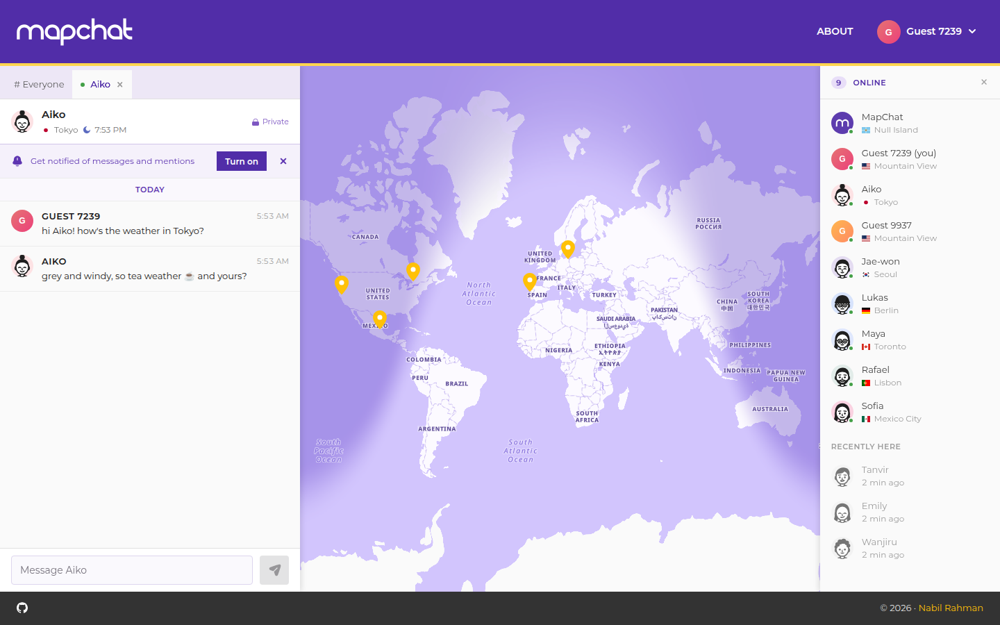
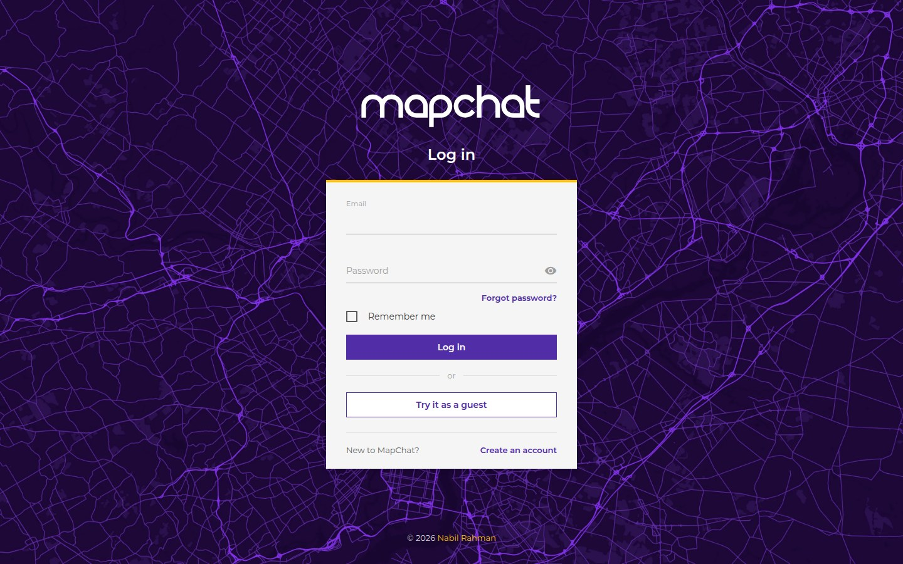
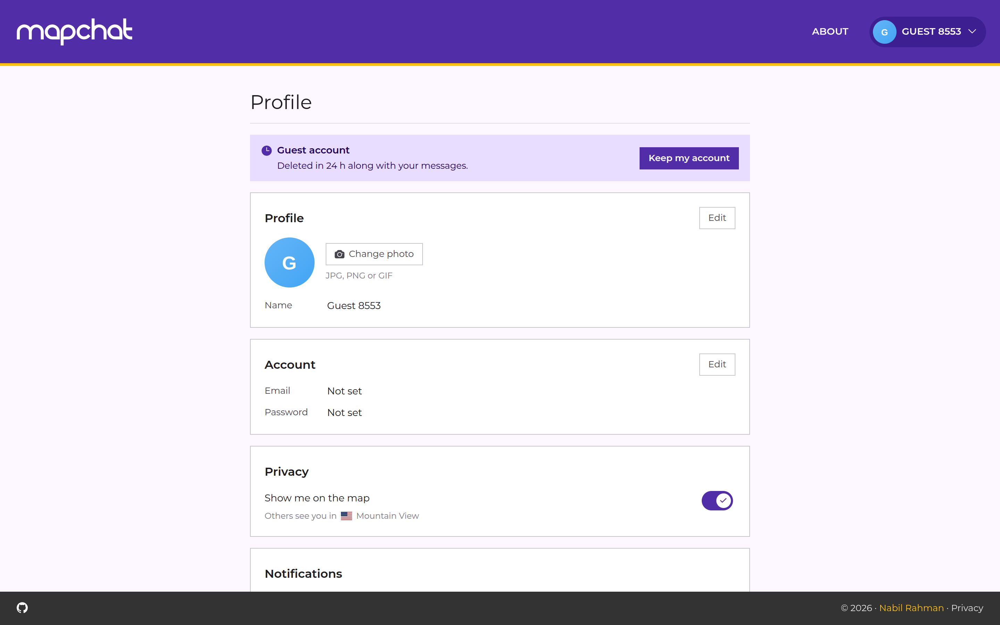
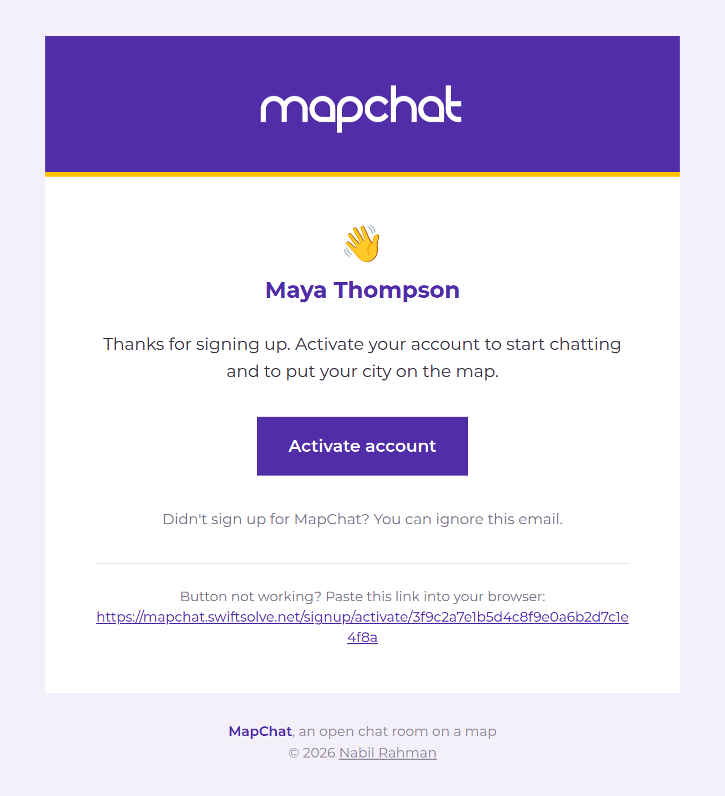

<div align="center">

<picture>
  <source media="(prefers-color-scheme: dark)" srcset="public/res/logo-mapchat-white.svg">
  
</picture>

An open chat room on a map, running on an MVC framework<br>
I wrote from scratch in PHP.

[](https://mapchat.swiftsolve.net)
[](https://github.com/nabilrhman/MapChat-MVC/actions/workflows/tests.yml)<br>
[](composer.json)
[](database/init.sql)
[](Dockerfile)
[](LICENSE)

**[Open MapChat](https://mapchat.swiftsolve.net)** &nbsp;·&nbsp;
**[AI chat](#ai-chat)** &nbsp;·&nbsp;
**[Run it locally](#run-it-locally)** &nbsp;·&nbsp;
**[Deploy for free](#deploy-for-free)** &nbsp;·&nbsp;
**[Project layout](#project-layout)**

</div>

---

## Overview

MapChat is an open chat room on a map. Everyone who signs in talks in the same
room, and a pin on the map shows which city each person is chatting from.

I built it in 2018 as a university project at Boise State University. The goal
was to understand what a web framework actually does, so instead of using one, I
wrote my own: the router, controllers, models, views, sessions and login are all
hand-written PHP.

In 2026 I came back to it to bring parts of it up to date.

[MapChat](https://mapchat.swiftsolve.net) runs on Render's free plan, which
sleeps when nobody visits; a GitHub Actions workflow visits it every 10 minutes
so it stays awake.

https://github.com/user-attachments/assets/06384a18-cd12-4e27-8cf0-530ab2463569

<sub>A quick tour of MapChat.</sub>

| The chat room | A private chat |
|---|---|
|  |  |

| Log in, or try it as a guest | Profile |
|---|---|
|  |  |

| Account activation email | Password reset email |
|---|---|
|  |  |

## Features

- One open chat room for everyone signed in, live over a WebSocket.
  Messages are up to 500 characters, at most 30 a minute, or 10 for a guest.
- Private chats in tabs of their own, with unread counts and "Typing...".
  Each opens with a header showing who you're talking to, and their city and
  local time.
- @mentions: type @ to pick someone; mentions show as chips.
- Emoji from the smile button under the message box.
- Voice typing: the mic beside an empty box listens, and what you said goes
  into the box to read over before sending. Groq's Whisper writes it out; when
  Groq is off or its free plan is used up for the minute, the browser's own
  speech recognition listens instead (Chrome, Safari and Edge).
- Notifications for private messages and @mentions, even with MapChat closed
  (Web Push). Turn them on from the chat or your profile. They're per
  browser, and logging out turns them off there.
- A map with a pin for each person online, placed from their IP address and
  rounded to about a kilometre, never from GPS, with their local time and a
  sun or moon.
- Hover someone, or a message's city, to point out their pin; click the city
  to fly the map to it. The night side of the world is shaded.
- Anyone can hide their pin and city from the map.
- MapChat, the room's AI, and AI characters who chat back: see
  [AI chat](#ai-chat).
- Try it as a guest without signing up. A guest account lasts 24 hours
  unless kept, then it's logged out and deleted.
- Accounts with email activation, password reset, nicknames and avatars.
- Delete your profile from the profile page, after a dialog asks first. Your
  messages, private chats, location and notifications go with it.
- Continue with Google on the login page, which makes the account the first
  time, or links it to the account with the same email. Someone with no photo
  of their own gets their Google photo.
- Works on phones, where the chat is a sheet over the map: drag it to the height you like, and tap its handle to switch between all of the chat and that height.

## AI chat

Two kinds of AI share the room, and Groq's chat API (`openai/gpt-oss-120b` by
default) writes what both say. Without `GROQ_API_KEY`, MapChat only greets and
the characters only follow their script.

**MapChat**, the room's own account. It has no pin on the map, and the
people list places it on Null Island:

- Says hello when someone walks into a quiet room, once a day per person.
- Answers someone nobody else answered, giving others 45 seconds first.
- Keeps a conversation going, and steps back when people talk to each other.
  An @MapChat always gets an answer.
- Answers private messages.

**The characters**, the nine people on the map, are AI too. Through
the day they play out stories from `database/demo-chat.php`, and:

- @mention one, or message them privately, and they answer in character,
  remembering what's happened in their stories so far.
- While a guest talks with one, the story waits for them.
- Asked whether they're real, they say they're AI.

Both keep replies short, tag who they're answering, and stop asking
questions once someone's done chatting. A room reply reads only the room's
recent messages, and a private reply only that chat. That text is sent to
Groq, which [says](https://console.groq.com/docs/your-data) it doesn't train
on what's sent to its API. The code is in `App/Models/Bot.php`.

The same key turns voice messages into text with Groq's
`whisper-large-v3-turbo` (`App/Groq.php`, `public/js/voice.js`). Its free plan
allows 2,000 recordings a day and 20 a minute for the whole site; past that,
the page has the browser listen instead. MapChat doesn't keep the recordings.

## How it's built


- **Framework:** a model-view-controller (MVC) framework written from scratch in
  PHP 8.4, in `Core/`. The app itself is in `App/`.
- **Database:** MySQL, queried with prepared statements to block SQL injection.
- **Views:** Twig 3 templates, which escape everything users type to block
  cross-site scripting. A strict Content-Security-Policy backs that up: a
  script runs only if it carries the page's one-time nonce, or a script that
  did loaded it (`Core/ContentSecurityPolicy.php`).
- **Requests:** a form, a request from a page or the chat socket that changes
  anything must say it comes from the site itself (its Origin or Referer),
  which blocks cross-site request forgery.
- **Front end:** the site's own CSS, in Material 3's colours and states
  (generated from MapChat's purple) with square corners, and Beer CSS for
  the form fields, scoped so it styles nothing else. Plain JavaScript with no
  jQuery, and axios for requests to the server.
- **Live chat:** one WebSocket per open chat page, served by a PHP process of
  its own on [amphp](https://amphp.org); see [Live chat](#live-chat).
- **Notifications:** while a chat page is in view it shows them itself; with
  MapChat closed they come by Web Push, sent by the chat worker with
  [minishlink/web-push](https://github.com/web-push-libs/web-push-php) and
  shown by a service worker, `public/sw.js`. Signed with VAPID keys; without
  them, only an open page notifies. How it all works, and setting it up, is in
  [docs/notifications.md](docs/notifications.md).
- **Icons:** the Solid weight of [Heroicons](https://heroicons.com) by
  Tailwind Labs, under the MIT licence, in one sprite, `public/icons.svg`. The GitHub mark is from Simple Icons.
- **Map:** MapLibre with OpenStreetMap data from OpenFreeMap, styled to match
  MapChat's colours. Browsers without WebGL get OpenStreetMap tiles through
  Leaflet instead, recoloured to the same theme in the browser. No API key is
  needed for either.
- **AI replies:** Groq's chat API, run by the chat worker; see
  [AI chat](#ai-chat).
- **Location:** looked up from the IP address someone logs in from, which is
  kept with their account. ipapi.co, ipwho.is and GeoJS are tried in turn,
  then ipstack when `IPSTACK_API_KEY` is set. The place is stored and shown
  rounded to two decimal places, about a kilometre.
- **Email:** Symfony Mailer, sending through any SMTP provider or Brevo's API.
- **Signing in with Google:** OpenID Connect, by hand in `App/Google.php`,
  with a state, a nonce and PKCE. The ID token comes straight from Google's
  token endpoint, so its claims are checked but not its signature, as the
  standard allows.
- **Sessions:** stored in MySQL rather than files, so restarting or waking up
  the container doesn't log anyone out.
- **Avatars:** uploaded from the browser straight to the site's own
  Cloudinary account. Without one, uploads are off and everyone keeps a
  drawn avatar.
- **Hosting:** a Docker image with Apache, PHP-FPM, the chat socket and the
  chat worker.

## Live chat

Each open chat page keeps one WebSocket, served by a PHP process of its own on
[amphp](https://amphp.org) in the same container as the site. New messages,
typing and who's online arrive the moment they happen, nothing is lost or
shown twice across reconnects and deploys, and if the socket can't connect the
page falls back to checking every second over HTTP, or every 8 seconds in a
hidden tab.

How it works, from sending and reconnecting to who's let in, is in
[docs/live-chat.md](docs/live-chat.md).

## Run it locally

You need Docker.

```bash
cp .env.example .env   # then set SECRET_KEY, e.g. to the output of: openssl rand -hex 32
docker compose up --build
```

Open http://localhost:8080 and either sign up or press **Try it as a guest**.

Nine made-up people around the world (`database/demo.sql`) keep the chat and
the map from looking empty, playing out the day's stories from
`database/demo-chat.php`. To start with an empty room instead, remove the
`demo.sql` line from `docker-compose.yml`.

With a Groq key (free at console.groq.com) as `GROQ_API_KEY` in `.env`,
MapChat and the demo people chat back; see [AI chat](#ai-chat).

Emails the app sends locally (account activation, password reset) don't go
out. They land in Mailpit, an inbox you can open at http://localhost:8025.

Code changes in `App/`, `Core/` and `public/` show up on reload, except in the
chat socket and worker, which keep the code they started with: run
`docker compose restart app` after changing `App/ChatSocket/`, `bin/` or a
model they use. After changing `composer.json` or the `Dockerfile`, run
`docker compose up --build` again.

To start over with an empty database:

```bash
docker compose down -v
```

### Tests

The tests cover the router, who can see which chat messages, mentions and
nicknames, whose browsers a Web Push goes to, and when MapChat and the demo
people answer. The chat socket's
tests start it as its own process and connect to it as pages do: private
messages reaching only the pair, the open room reaching everyone, sending
again after a lost answer, catching up after a restart with more than a page
missed, typing, presence across tabs, and logging out. They run
against their own database, `mapchat_test`, which is rebuilt from
`database/init.sql` each run, so the app's data is never touched:

```bash
docker compose run --rm --build test
```

With the app running, `npm install` once and then `npm run a11y` checks
every page for accessibility problems with axe-core, before and after signing
in, at desktop and phone widths, in Playwright using the Chrome installed on
the machine (`tests/browser/`). It draws on the GPU; `MAPCHAT_GPU=0` turns
that off.

### Settings

All settings come from environment variables. `.env.example` lists them with
explanations. The main ones:

| Variable | What it does |
|---|---|
| `APP_URL` | Public address of the site. Used in links inside emails, by the check that a form, a request from a page or the chat socket comes from the site itself, to mark cookies Secure when it's `https://`, and as the default `VAPID_SUBJECT`. Without it, the address each request came to |
| `SHOW_ERRORS` | `true` shows an error's details on the page. Leave it `false` on a real site, where errors go to the log |
| `DB_HOST`, `DB_PORT`, `DB_NAME`, `DB_USER`, `DB_PASSWORD` | Database connection |
| `DB_SSL` | `true` for hosted MySQL that requires TLS |
| `DB_SSL_CA` | Optional. The CA certificates `DB_SSL` checks the database against. Default `/etc/ssl/certs/ca-certificates.crt` |
| `SECRET_KEY` | Secret for hashing login and reset tokens. Required |
| `MAILER_DSN` | Where outgoing email goes: an SMTP address, or `brevo+api://API_KEY@default`. Empty turns email off: new accounts are active at once, and a password reset says it couldn't send the email. Locally it defaults to Mailpit |
| `MAIL_FROM` | Who emails come from. Default `MapChat <no-reply@localhost>`. Brevo needs an address on a domain verified with it |
| `IPSTACK_API_KEY` | Optional. Adds ipstack as the last place to look up where a visitor is, after ipapi.co, ipwho.is and GeoJS. Last because its free plan is plain HTTP, with the key in the address |
| `DEV_FAKE_IP` | Used in place of any private or reserved IP, in any environment. Locally every visitor has one, so this public IP puts them on the map. Leave it empty on a host |
| `DEMO_TIMEZONE` | Optional. Where the demo people's day starts at midnight. Default `America/Toronto` |
| `DEMO_SPEED` | Optional, for watching the demo chat locally: `60` plays the whole day in 24 minutes. Leave empty on a real site |
| `GROQ_API_KEY` | Optional. Lets MapChat and the demo people chat back, and writes out voice messages, through Groq's free plan (console.groq.com). Without it, MapChat only greets, and the browser writes out voice messages where it can |
| `MAPCHAT_MODEL` | Optional. The Groq model they write with. Default `openai/gpt-oss-120b` |
| `GOOGLE_CLIENT_ID`, `GOOGLE_CLIENT_SECRET` | Optional. An OAuth client (Web application) from console.cloud.google.com/apis/credentials, with `APP_URL/login/google/callback` as its redirect URI. With both, the login page offers Continue with Google |
| `CLOUDINARY_CLOUD_NAME`, `CLOUDINARY_UPLOAD_PRESET` | The Cloudinary account and unsigned upload preset photo uploads go to. Both are needed for uploads, with no default: with either empty, uploads are off and the profile says so. Removing a photo still works |
| `CHAT_SOCKET_HOST` | Optional. The address the chat socket listens on inside the container, behind Apache's `/ws`. Default `127.0.0.1` |
| `CHAT_SOCKET_PORT` | Optional. The port the chat socket listens on. Default `8090` |
| `CHAT_PRESENCE_GRACE_SECONDS` | Optional. How long someone still shows online after their last chat page closes. Default `10` |
| `CHAT_SESSION_CHECK_SECONDS` | Optional. How often the chat socket closes the pages of people who logged out or whose guest account ran out. Default `15` |
| `VAPID_PUBLIC_KEY`, `VAPID_PRIVATE_KEY` | Optional. The key pair for Web Push, so notifications reach people with MapChat closed. Make it once and keep it ([docs/notifications.md](docs/notifications.md)) |
| `VAPID_SUBJECT` | Optional. Who push services can contact about the site, `https://` or `mailto:`. Default `APP_URL` |

## Deploy for free

MapChat runs free as a Docker container on [Render](https://render.com), with
the database on [TiDB Cloud Starter](https://tidbcloud.com). The steps, from
creating the database to the optional email, avatar and AI settings, are in
[docs/deploy.md](docs/deploy.md).

## Project layout

```
Core/            The framework: router, base controller and model, views, icons, errors
App/Controllers/ One class per page or action
App/Models/      Database access for users, chats, locations, push subscriptions
                 and remembered logins; Bot: when MapChat and the demo people
                 answer, and what they read; DemoChat: the demo people's day;
                 Schema: bringing an older database up to date
App/*.php        Config (settings), Auth (who's logged in), Google (signing in
                 with Google), Mail, Token, Flash
                 (one-time messages), Avatar (drawn faces), Mention (@mentions,
                 and how each person's name is shown), Push (Web Push: whose
                 browsers each new message goes to, and sending it), Groq
                 (AI replies and voice to text), VoiceClip (checks a recording)
App/ChatSocket/  The live chat: who's let in (Handshake), and what each page
                 gets (Hub)
bin/             chat-socket.php and chat-worker.php, run by docker/start.sh
App/Views/       Twig templates
public/          Web root: index.php, CSS, JavaScript (messages.js talks to the
                 chat socket, mentions.js is the @ list and chips,
                 emojiPicker.js the emoji grid, voice.js voice typing,
                 notifications.js turns notifications on), sw.js (shows Web
                 Push notifications), images and icons.svg
database/        init.sql (schema and welcome messages), demo.sql (optional
                 sample people), demo-chat.php (what they say each day),
                 demo-voices.php (how each of them writes, for the AI),
                 migrate.php (brings an older database up to date, run when
                 the container starts)
tests/           PHPUnit tests; tests/browser/ the Playwright checks (npm run a11y)
docs/images/     The video, screenshots and diagram in this README
docs/diagrams/   Draws the diagram: node docs/diagrams/draw.ts
docs/video/      Records the tour at the top with Playwright (npm run tour) and
                 takes the screenshots (npm run screenshots)
docs/live-chat.md How the live chat works
docs/notifications.md How notifications and Web Push work
docs/deploy.md   How to deploy it for free
docs/load-test.* The load test and its report, with raw results in docs/load-test-results/
AGENTS.md        The coding rules, for people and AI agents alike
```

## Author

Nabil Rahman · [nabilr.com](https://nabilr.com)
