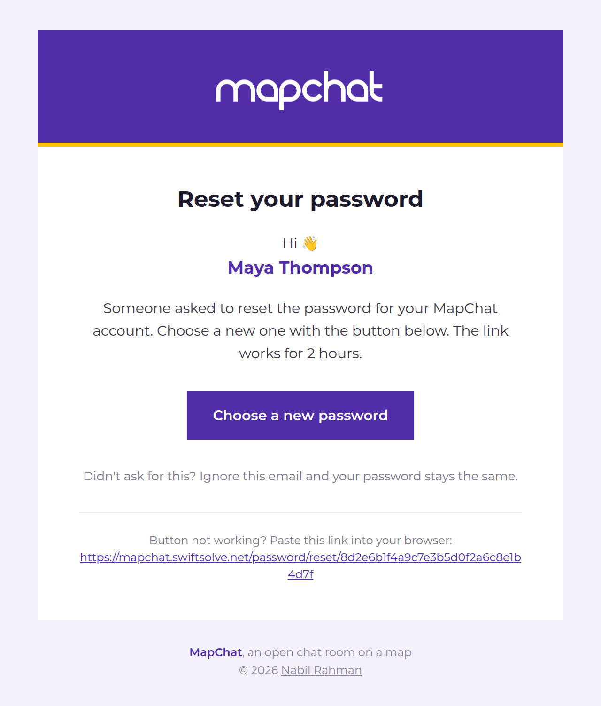

<div align="center">

<picture>
  <source media="(prefers-color-scheme: dark)" srcset="public/res/logo-mapchat-white.svg">
  
</picture>

An open chat room on a map, running on an MVC framework<br>
I wrote from scratch in PHP.

[](https://mapchat.swiftsolve.net)
[](https://github.com/nabilrhman/MapChat-MVC/actions/workflows/tests.yml)<br>
[](composer.json)
[](database/init.sql)
[](Dockerfile)
[](LICENSE)

**[Open MapChat](https://mapchat.swiftsolve.net)** &nbsp;·&nbsp;
**[AI chat](#ai-chat)** &nbsp;·&nbsp;
**[Run it locally](#run-it-locally)** &nbsp;·&nbsp;
**[Deploy for free](#deploy-for-free)** &nbsp;·&nbsp;
**[Project layout](#project-layout)**

</div>

---

## Overview

MapChat is an open chat room on a map. Everyone who signs in talks in the same
room, and a pin on the map shows which city each person is chatting from.

I built it in 2018 as a university project at Boise State University. The goal
was to understand what a web framework actually does, so instead of using one, I
wrote my own: the router, controllers, models, views, sessions and login are all
hand-written PHP.

In 2026 I came back to it to bring parts of it up to date.

[MapChat](https://mapchat.swiftsolve.net) runs on Render's free plan, which
sleeps when nobody visits; a GitHub Actions workflow visits it every 10 minutes
so it stays awake.

https://github.com/user-attachments/assets/06384a18-cd12-4e27-8cf0-530ab2463569

<sub>A quick tour of MapChat.</sub>

| The chat room |
|---|
|  |

| Log in, or try it as a guest | Profile |
|---|---|
|  |  |

| Account activation email | Password reset email |
|---|---|
|  |  |

## Features

- One open chat room for everyone signed in, live over a WebSocket.
- Private chats in tabs of their own, with unread counts and "Typing...".
- @mentions: type @ to pick someone; mentions show as chips.
- A map with a pin for each person online, at city level, never an exact
  location, with their local time and a sun or moon.
- Hover someone, or a message's city, to point out their pin; click the city
  to fly the map to it. The night side of the world is shaded.
- Anyone can hide their pin and city from the map.
- MapChat, the room's AI, and AI characters who chat back: see
  [AI chat](#ai-chat).
- Try it as a guest without signing up; guest accounts last 24 hours unless
  kept.
- Accounts with email activation, password reset, nicknames and avatars.
- Works on phones, where the map folds away to give the chat the room.

## AI chat

Two kinds of AI share the room, and Groq's chat API (`openai/gpt-oss-120b` by
default) writes what both say. Without `GROQ_API_KEY`, MapChat only greets and
the characters only follow their script.

**MapChat**, the room's own account, pinned on Null Island:

- Says hello when someone walks into a quiet room, once a day per person.
- Answers someone nobody else answered, giving others 45 seconds first.
- Keeps a conversation going, and steps back when people talk to each other.
  An @MapChat always gets an answer.
- Answers private messages.

**The characters**, the nine people on the map, are AI too. Through
the day they play out stories from `database/demo-chat.php`, and:

- @mention one, or message them privately, and they answer in character,
  remembering what's happened in their stories so far.
- While a guest talks with one, the story waits for them.
- Asked whether they're real, they say they're AI.

Both keep replies short, tag who they're answering, and stop asking
questions once someone's done chatting. A room reply reads only the room's
recent messages, and a private reply only that chat. That text is sent to
Groq, which [says](https://console.groq.com/docs/your-data) it doesn't train
on what's sent to its API. The code is in `App/Models/Bot.php`.

## How it's built


- **Framework:** a model-view-controller (MVC) framework written from scratch in
  PHP 8.4, in `Core/`. The app itself is in `App/`.
- **Database:** MySQL, queried with prepared statements to block SQL injection.
- **Views:** Twig 3 templates, which escape everything users type to block
  cross-site scripting.
- **Front end:** the site's own CSS, in Material 3's colours and states
  (generated from MapChat's purple) with square corners, and Beer CSS for
  the form fields, scoped so it styles nothing else. Plain JavaScript with no
  jQuery, and axios for requests to the server.
- **Live chat:** one WebSocket per open chat page, served by a PHP process of
  its own on [amphp](https://amphp.org); see [Live chat](#live-chat).
- **Icons:** the Bold weight of the [Solar icon set](https://www.figma.com/community/file/1166831539721848736)
  by 480 Design, under [CC BY 4.0](https://creativecommons.org/licenses/by/4.0/),
  in one sprite, `public/icons.svg`. The GitHub mark is from Simple Icons.
- **Map:** MapLibre with OpenStreetMap data from OpenFreeMap, styled to match
  MapChat's colours. Browsers without WebGL get OpenStreetMap tiles through
  Leaflet instead, recoloured to the same theme in the browser. No API key is
  needed for either.
- **AI replies:** Groq's chat API, run by the chat worker; see
  [AI chat](#ai-chat).
- **Location:** looked up from the visitor's IP address with ipapi.co, or
  ipstack when `IPSTACK_API_KEY` is set.
- **Email:** Symfony Mailer, sending through any SMTP provider or Brevo's API.
- **Sessions:** stored in MySQL rather than files, so restarting or waking up
  the container doesn't log anyone out.
- **Avatars:** uploaded from the browser straight to Cloudinary.
- **Hosting:** a Docker image with Apache, PHP-FPM, the chat socket and the
  chat worker.

## Live chat

Each open chat page keeps one WebSocket, served by a PHP process of its own on
[amphp](https://amphp.org) in the same container as the site. New messages,
typing and who's online arrive the moment they happen, nothing is lost or
shown twice across reconnects and deploys, and if the socket can't connect the
page falls back to checking every second over HTTP.

How it works, from sending and reconnecting to who's let in, is in
[docs/live-chat.md](docs/live-chat.md).

## Run it locally

You need Docker.

```bash
cp .env.example .env   # then set SECRET_KEY, e.g. to the output of: openssl rand -hex 32
docker compose up --build
```

Open http://localhost:8080 and either sign up or press **Try it as a guest**.

Nine made-up people around the world (`database/demo.sql`) keep the chat and
the map from looking empty, playing out the day's stories from
`database/demo-chat.php`. To start with an empty room instead, remove the
`demo.sql` line from `docker-compose.yml`.

With a Groq key (free at console.groq.com) as `GROQ_API_KEY` in `.env`,
MapChat and the demo people chat back; see [AI chat](#ai-chat).

Emails the app sends locally (account activation, password reset) don't go
out. They land in Mailpit, an inbox you can open at http://localhost:8025.

Code changes in `App/`, `Core/` and `public/` show up on reload, except in the
chat socket and worker, which keep the code they started with: run
`docker compose restart app` after changing `App/ChatSocket/`, `bin/` or a
model they use. After changing `composer.json` or the `Dockerfile`, run
`docker compose up --build` again.

To start over with an empty database:

```bash
docker compose down -v
```

### Tests

The tests cover the router, who can see which chat messages, mentions and
nicknames, and when MapChat and the demo people answer. The chat socket's
tests start it as its own process and connect to it as pages do: private
messages reaching only the pair, the open room reaching everyone, sending
again after a lost answer, catching up after a restart with more than a page
missed, typing, presence across tabs, and logging out. They run
against their own database, `mapchat_test`, which is rebuilt from
`database/init.sql` each run, so the app's data is never touched:

```bash
docker compose run --rm --build test
```

### Settings

All settings come from environment variables. `.env.example` lists them with
explanations. The main ones:

| Variable | What it does |
|---|---|
| `APP_URL` | Public address of the site, used in links inside emails |
| `DB_HOST`, `DB_PORT`, `DB_NAME`, `DB_USER`, `DB_PASSWORD` | Database connection |
| `DB_SSL` | `true` for hosted MySQL that requires TLS |
| `SECRET_KEY` | Secret for hashing login and reset tokens. Required |
| `MAILER_DSN` | Where outgoing email goes: an SMTP address, or `brevo+api://API_KEY@default`. Empty turns email off (locally it defaults to Mailpit) |
| `IPSTACK_API_KEY` | Optional. Without it, ipapi.co is used |
| `DEV_FAKE_IP` | Locally every visitor has a private IP; this public IP is used for the map instead |
| `DEMO_TIMEZONE` | Optional. Where the demo people's day starts at midnight. Default `America/Toronto` |
| `DEMO_SPEED` | Optional, for watching the demo chat locally: `60` plays the whole day in 24 minutes. Leave empty on a real site |
| `GROQ_API_KEY` | Optional. Lets MapChat and the demo people chat back, through Groq's free plan (console.groq.com). Without it, MapChat only greets |
| `MAPCHAT_MODEL` | Optional. The Groq model they write with. Default `openai/gpt-oss-120b` |
| `CLOUDINARY_CLOUD_NAME`, `CLOUDINARY_UPLOAD_PRESET` | Where avatar uploads go |
| `CHAT_SOCKET_PORT` | Optional. The port the chat socket listens on inside the container, behind Apache's `/ws`. Default `8090` |

## Deploy for free

The app runs as a Docker container on [Render](https://render.com)'s free plan,
with the database on [TiDB Cloud Starter](https://tidbcloud.com), a free
MySQL-compatible service.

1. Create a TiDB Cloud Starter cluster. In its SQL editor, run
   `CREATE DATABASE mapchat; USE mapchat;`, then the contents of `database/init.sql`,
   and, if you want the sample conversation, `database/demo.sql`.
2. In Render, choose **New > Blueprint** and pick this repository. Render reads
   `render.yaml` and asks for the database host, user and password from TiDB's
   **Connect** dialog, and for `APP_URL` (the `onrender.com` address).
3. Optional settings:
   - `MAILER_DSN` for activation and password-reset emails. Render's free plan
     blocks SMTP, so use `brevo+api://API_KEY@default`.
   - `CLOUDINARY_CLOUD_NAME` and `CLOUDINARY_UPLOAD_PRESET` for avatar uploads.
   - `GROQ_API_KEY` for MapChat and the AI characters to chat back.

Free Render services sleep after 15 minutes without visitors; the `Keep awake`
workflow visits every 10 minutes, well within Render's 750 free hours a month.
The container also brings an older database up to date when it starts.

<details>
<summary>Upgrading a database from before the automatic upgrades</summary>

```sql
ALTER TABLE chats
  ADD COLUMN to_email VARCHAR(255) NULL DEFAULT NULL AFTER email,
  ADD KEY fk_m_to_email (to_email),
  ADD CONSTRAINT fk_m_to_email FOREIGN KEY (to_email) REFERENCES users (email)
    ON DELETE CASCADE ON UPDATE CASCADE;

ALTER TABLE userinfo
  ADD COLUMN country CHAR(2) AFTER city,
  ADD COLUMN timezone VARCHAR(64) AFTER country;
```

</details>

## Project layout

```
Core/            The framework: router, base controller and model, views, icons, errors
App/Controllers/ One class per page or action
App/Models/      Database access for users, chats and locations, and Bot:
                 when MapChat and the demo people answer, and what they read
App/Mention.php  @mentions, and how each person's name is shown
App/ChatSocket/  The live chat: who's let in (Handshake), and what each page
                 gets (Hub)
bin/             chat-socket.php and chat-worker.php, run by docker/start.sh
App/Views/       Twig templates
public/          Web root: index.php, CSS, JavaScript (messages.js talks to the
                 chat socket, mentions.js is the @ list and chips), images and
                 icons.svg
database/        init.sql (schema and welcome messages), demo.sql (optional
                 sample people), demo-chat.php (what they say each day),
                 migrate.php (adds columns an older database is missing, run
                 when the container starts)
tests/           PHPUnit tests
docs/images/     The video, screenshots and diagram in this README
docs/diagrams/   Draws the diagram: node docs/diagrams/draw.ts
docs/video/      Records the tour at the top: python3 docs/video/record.py
docs/live-chat.md How the live chat works
docs/load-test.* The load test and its report, with raw results in docs/load-test-results/
```

## Author

Nabil Rahman · [nabilr.com](https://nabilr.com)
